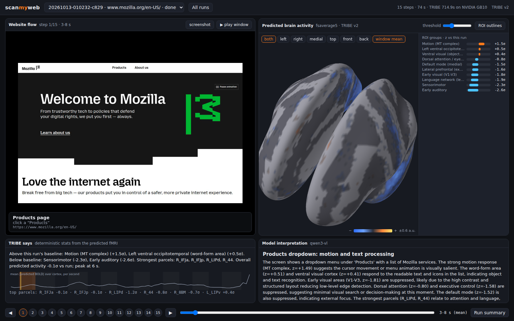
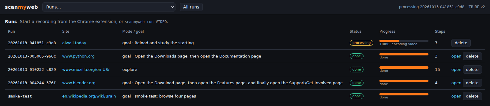

# scanmyweb

Drive a website with a virtual mouse, record the flow, predict the average human brain's fMRI
response to it with Meta's [TRIBE v2](https://github.com/facebookresearch/tribev2), and let a local
LLM explain what the prediction means. Everything runs on your machine.

```
Chrome extension ──HTTP──▶ local server (FastAPI) ──▶ TRIBE v2 worker (GPU) ──▶ stats ──▶ local LLM
   virtual mouse +            records frames + steps      preds (n_sec × 20484)    ROI z-scores   interpretation
   screencast                 builds stimulus.mp4         on fsaverage5                            per step
                                                                   │
                                        slideshow: website flow | 3D brain | TRIBE says + model interpretation
```

## What you get



A slideshow per run (`http://127.0.0.1:8787/view/<run>`):

- **Left**: the recorded website flow (video scrubbed to the step, or the step screenshot) with the
  action the virtual mouse took.
- **Right**: predicted cortical activity on the inflated fsaverage5 surface (three.js), averaged
  over the step's window or scrubbed second by second; ROI z-scores on the side.
- **Bottom left, "TRIBE says"**: deterministic statistics from the predictions (which ROI groups are
  above/below this run's baseline, strongest HCP-MMP1 parcels, peak second) plus a timeline.
- **Bottom right, "Model interpretation"**: the local LLM's explanation of the step, a UX note,
  and a run-level summary.

## Requirements

- Linux, NVIDIA GPU (TRIBE needs ~10 GB; qwen3-vl 32B ~20 GB), `ffmpeg`, `ffprobe`, Google Chrome.
- A working TRIBE v2 environment: a Python 3.11 venv with torch + `tribev2` installed, the
  `facebook/tribev2` weights in a Hugging Face cache, and the fsaverage/HCP-MMP1 atlas in an MNE data
  dir. By default the server looks in `~/tribev2-eval` (`.venv`, `hf_cache`, `mne_data`); point
  elsewhere with `TRIBE_EVAL_DIR` or the individual overrides `SCANMYWEB_TRIBE_PYTHON`,
  `SCANMYWEB_HF_HOME`, `SCANMYWEB_MNE_DATA`, `SCANMYWEB_TRIBE_CACHE` (env or `scanmyweb.toml`).
- [Ollama](https://ollama.com) with `qwen3-vl:32b-instruct` pulled (default), or any model preset
  from `server/llm/models.yaml`.
- `uv` for the server venv.

## Setup

```bash
make setup                       # uv venv + deps into .venv
make export-mesh                 # once: server/static/mesh.json (fsaverage5 + HCP parcels), uses the TRIBE venv
.venv/bin/python -m cli.scanmyweb models   # check that Ollama and the presets are reachable
make serve                       # http://127.0.0.1:8787
```

Load the extension: `chrome://extensions` → Developer mode → *Load unpacked* → the `extension/`
folder. Click the toolbar icon, enter a URL, pick **Goal** (type what the virtual mouse should
achieve) or **Auto-explore**, choose models, press **Start recording**. Chrome shows its
"is being debugged" banner while the virtual mouse works; that is expected.

## How a run works

1. The extension opens the URL in a new tab, attaches the DevTools protocol and starts a screencast.
2. Every step: the page's interactive elements get red numbered badges (set-of-marks), a screenshot
   plus the element list goes to `POST /api/agent/step`, the vision model answers with one JSON action
   (`click`, `type`, `scroll`, `key`, `navigate`, `wait`, `done`). The extension animates a visible
   cursor to the element and dispatches real mouse/keyboard events. The recording clock pauses while
   the model thinks, so the 90 s budget (`max_flow_seconds`) is all interaction.
3. `finish` builds a constant-10-fps `stimulus.mp4` from the frames, then the TRIBE worker
   (`server/pipeline/tribe_worker.py`, run in the TRIBE venv) predicts one row per second.
4. `server/interpret/stats.py` turns rows into ROI/parcel statistics per step; `writer.py` asks the
   interpretation model for text; everything lands in `data/runs/<id>/slides.json`.

Processing takes roughly 12× the recording length on a GB10 (V-JEPA2 is the bottleneck). The run list
at `http://127.0.0.1:8787` shows live progress:



### Without the extension

```bash
# drive Chrome over CDP from the CLI (headless or visible), same server loop
.venv/bin/python -m cli.scanmyweb agent https://example.com --goal "open the pricing page" --headless
.venv/bin/python -m cli.scanmyweb agent https://example.com --explore

# or feed an existing screen recording (optionally with a steps.json)
.venv/bin/python -m cli.scanmyweb run recording.mp4 --url https://example.com
```

## Models are plug-and-play

`server/llm/models.yaml` lists presets (name → provider + model id + `vision` flag). Providers live
in `server/llm/`: `ollama.py` and `openai_compat.py` (vLLM, LM Studio, llama.cpp server…). Add a
model = add a YAML entry; add a backend = subclass `Provider` and register it in `PROVIDERS`.
Navigation needs a vision model; interpretation works with text-only models too. Pick per run in the
popup, or set defaults in `scanmyweb.toml`:

```toml
nav_model = "qwen3-vl"
interp_model = "qwen3-text"
max_flow_seconds = 90
```

## Reading the results honestly

- TRIBE v2 predicts the **average-subject fMRI response** to the video of the screen. It is not an
  engagement, attention, emotion or quality score.
- In this pipeline only the **video modality** carries stimulus information: the recording is silent
  and the LLaMA 3.2 text encoder (gated on Hugging Face) is not loaded. Activity in auditory or
  language regions is model prior plus visual input, not comprehension of the page's words.
- BOLD is slow: each one-second row reflects several seconds of content around it. Steps shorter
  than two seconds are widened before statistics are computed.
- All z-scores are relative to the run's own baseline, so compare steps within a run, not across runs.

## Layout

```
extension/   manifest, background.js (driver), smw_core.js (marks + cursor), content.js, popup
server/      app.py (API), config.py, llm/ (providers + presets), agent/ (planner), pipeline/
             (recorder, TRIBE worker, mesh export, job queue), interpret/ (stats, writer), static/ (UI)
cli/         scanmyweb.py (serve | run | agent | export-mesh | models | runs), cdp_agent.py
data/runs/   one folder per run: frames/, steps/, stimulus.mp4, tribe/, slides.json
```

`make check` runs ruff and the unit tests.

## Status

Built and verified on one machine (NVIDIA GB10, Ollama + qwen3-vl:32b-instruct): goal and
auto-explore runs driven by the CLI CDP agent and by the extension loaded in headless Chromium,
plus `scanmyweb run` on a plain screen recording. Expect rough edges on other setups.

## Licenses

TRIBE v2 code and weights are released under **CC BY-NC 4.0** (non-commercial) by Meta; the HCP-MMP1.0
parcellation requires citing Glasser et al. 2016. This project's own code may be used under the terms
you choose for it, but any use of TRIBE through it is bound by Meta's license.
