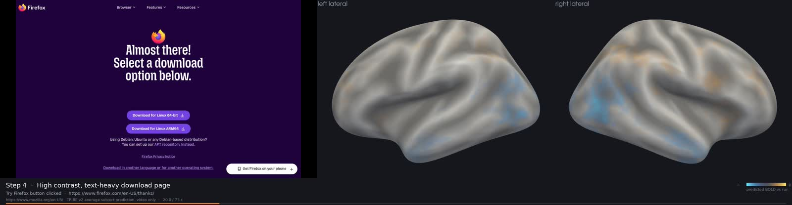
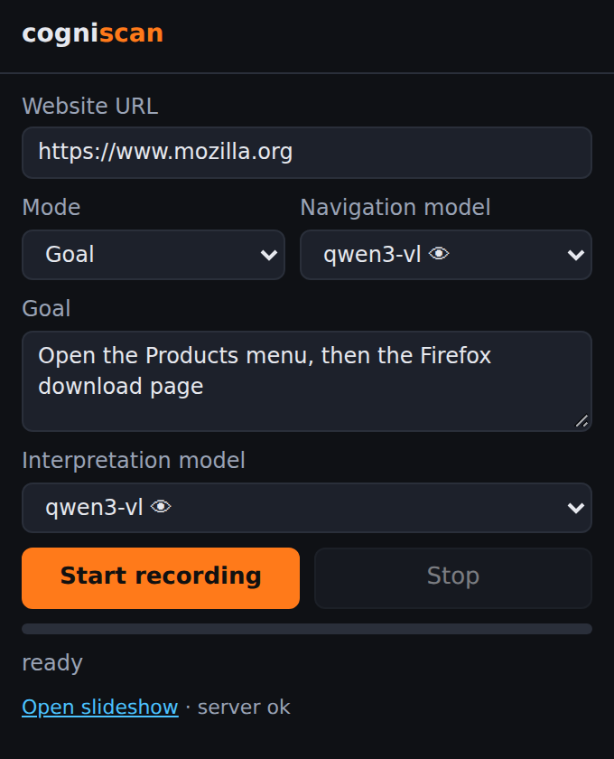

# cogniscan

[](https://github.com/kt-12/cogniscan/actions/workflows/ci.yml)
[](pyproject.toml)
[](https://github.com/astral-sh/ruff)
[](tests)
[](ui/tsconfig.app.json)
[](https://oxc.rs/docs/guide/usage/linter)

Drive a website with a virtual mouse, record the flow, predict the average human brain's fMRI
response to it with Meta's [TRIBE v2](https://github.com/facebookresearch/tribev2), and let a local
LLM explain what the prediction means. Everything runs on your machine.

```
Chrome extension ──HTTP──▶ local server (FastAPI) ──▶ TRIBE v2 worker (GPU) ──▶ stats ──▶ local LLM
   virtual mouse +            records frames + steps      preds (n_sec × 20484)    ROI z-scores   interpretation
   screencast                 builds stimulus.mp4         on fsaverage5                            per step
                                                                   │
                       viewer (React + NiiVue): website flow | 3D brain | TRIBE says + model interpretation
                       video export (PyVista): website | left + right brain, animated per second, captions
```

## What you get


A viewer per run (`http://127.0.0.1:8787/view/<run>`):

- **Left**: the recorded website flow (video, or the step screenshot with the clicked element boxed)
  with the action the virtual mouse took.
- **Right**: predicted cortical activity on the inflated fsaverage5 surface, rendered with
  [NiiVue](https://github.com/niivue/niivue). Per-second animation or the mean over the step's window;
  lateral / medial / top / front / back presets, drag to orbit, colormap, threshold and range; click an
  ROI group to highlight its parcels on the surface and isolate its time course.
- **Bottom tabs**: **TRIBE says** (deterministic statistics: which ROI groups are above/below this
  run's baseline, strongest HCP-MMP1 parcels, peak second, plus a per-second timeline of all groups),
  **Interpretation** (the local LLM's explanation of the step and a UX note), **Run summary**,
  **Steps**.
- **Transport bar**: play the whole run with the brain animating in sync with the video, scrub, jump
  between steps, loop a step, 0.5×/1×/2×. Keyboard: space, ←/→ (shift for 5 s), [ ] for steps, Home/End.
- **Export video**: a shareable MP4 of the run, website on the left and both hemispheres on the right,
  predictions interpolated between seconds, with a caption strip (step, headline, URL, progress).



## Requirements

- Linux, NVIDIA GPU (TRIBE needs ~10 GB; qwen3-vl 32B ~20 GB), `ffmpeg`, `ffprobe`, Google Chrome,
  `node` ≥ 20 (to build the viewer), `uv` for the server venv.
- A working TRIBE v2 environment: a Python 3.11 venv with torch + `tribev2` installed, the
  `facebook/tribev2` weights in a Hugging Face cache, and the fsaverage/HCP-MMP1 atlas in an MNE data
  dir. The same venv needs `nibabel`, `nilearn` and `pyvista` (surface export and video rendering run
  there). By default the server looks in `~/tribev2-eval` (`.venv`, `hf_cache`, `mne_data`); point
  elsewhere with `TRIBE_EVAL_DIR` or the individual overrides `COGNISCAN_TRIBE_PYTHON`,
  `COGNISCAN_HF_HOME`, `COGNISCAN_MNE_DATA`, `COGNISCAN_TRIBE_CACHE` (env or `cogniscan.toml`).
- [Ollama](https://ollama.com) with `qwen3-vl:32b-instruct` pulled (default), or any model preset
  from `server/llm/models.yaml`.

## Setup

```bash
make setup                       # uv venv + deps into .venv, then builds the viewer (ui/ → server/static/dist)
make export-mesh                 # once: server/static/surf/ (fsaverage5 GIfTI + sulc + HCP parcels), uses the TRIBE venv
.venv/bin/python -m cli.cogniscan models   # check that Ollama and the presets are reachable
make serve                       # http://127.0.0.1:8787
```

Load the extension: `chrome://extensions` → Developer mode → *Load unpacked* → the `extension/`
folder. Click the toolbar icon, enter a URL, pick **Goal** (type what the virtual mouse should
achieve) or **Auto-explore**, choose models, press **Start recording**. Chrome shows its
"is being debugged" banner while the virtual mouse works; that is expected.



## How a run works

1. The extension opens the URL in a new tab, attaches the DevTools protocol and starts a screencast.
2. Every step: the page's interactive elements get red numbered badges (set-of-marks), a screenshot
   plus the element list goes to `POST /api/agent/step`, the vision model answers with one JSON action
   (`click`, `type`, `scroll`, `key`, `navigate`, `wait`, `done`). The extension animates a visible
   cursor to the element and dispatches real mouse/keyboard events. The recording clock pauses while
   the model thinks, so the 90 s budget (`max_flow_seconds`) is all interaction.
3. `finish` builds a constant-10-fps `stimulus.mp4` from the frames, then the TRIBE worker
   (`server/pipeline/tribe_worker.py`, run in the TRIBE venv) predicts one row per second and also
   writes the per-hemisphere `lh/rh.func.gii` the viewer animates.
4. `server/interpret/stats.py` turns rows into ROI/parcel statistics per step; `writer.py` asks the
   interpretation model for text; everything lands in `data/runs/<id>/slides.json`.

Processing takes roughly 12× the recording length on a GB10 (V-JEPA2 is the bottleneck). The run list
at `http://127.0.0.1:8787` shows live progress:


### Exporting a video

Press **Export video** in the viewer (or the film icon in the run list), or from the CLI:

```bash
.venv/bin/python -m cli.cogniscan export-video 20261013-010232-c829            # lateral views, 3200×830
.venv/bin/python -m cli.cogniscan export-video 20261013-010232-c829 --views four   # + medial row, 3200×1550
```

`server/pipeline/video_export.py` renders the brain with PyVista off-screen in the TRIBE venv (a 74 s
run takes about 15 s), decodes the recording with ffmpeg, draws the caption strip with Pillow and
encodes with NVENC when available. The file is `data/runs/<id>/export.mp4`, served at
`/api/runs/<id>/export.mp4`.

### Without the extension

```bash
# drive Chrome over CDP from the CLI (headless or visible), same server loop
.venv/bin/python -m cli.cogniscan agent https://example.com --goal "open the pricing page" --headless
.venv/bin/python -m cli.cogniscan agent https://example.com --explore

# or feed an existing screen recording (optionally with a steps.json)
.venv/bin/python -m cli.cogniscan run recording.mp4 --url https://example.com
```

## Models are plug-and-play

`server/llm/models.yaml` lists presets (name → provider + model id + `vision` flag). Providers live
in `server/llm/`: `ollama.py` and `openai_compat.py` (vLLM, LM Studio, llama.cpp server…). Add a
model = add a YAML entry; add a backend = subclass `Provider` and register it in `PROVIDERS`.
Navigation needs a vision model; interpretation works with text-only models too. Pick per run in the
popup, or set defaults in `cogniscan.toml`:

```toml
nav_model = "qwen3-vl"
interp_model = "qwen3-text"
max_flow_seconds = 90
```

## Reading the results honestly

- TRIBE v2 predicts the **average-subject fMRI response** to the video of the screen. It is not an
  engagement, attention, emotion or quality score.
- In this pipeline only the **video modality** carries stimulus information: the recording is silent
  and the LLaMA 3.2 text encoder (gated on Hugging Face) is not loaded. Activity in auditory or
  language regions is model prior plus visual input, not comprehension of the page's words.
- BOLD is slow: each one-second row reflects several seconds of content around it. Steps shorter
  than two seconds are widened before statistics are computed.
- All z-scores are relative to the run's own baseline, so compare steps within a run, not across runs.

## Layout

```
extension/   manifest, background.js (driver), cogniscan_core.js (marks + cursor), content.js, popup
server/      app.py (API + serves the built viewer), config.py, llm/ (providers + presets), agent/ (planner),
             pipeline/ (recorder, TRIBE worker, surfaces + mesh export, video export, job queue),
             interpret/ (stats, writer), static/dist (built viewer, committed), static/surf (generated)
ui/          React 19 + Vite + Tailwind 4 + shadcn/ui + NiiVue viewer (src/pages, src/components, src/hooks)
cli/         cogniscan.py (serve | run | agent | export-video | export-mesh | models | runs), cdp_agent.py
data/runs/   one folder per run: frames/, steps/, stimulus.mp4, tribe/, slides.json, export.mp4
```

`make check` runs ruff, pytest, `tsc` and the UI linter. `make ui-dev` starts the viewer with hot
reload on :5173, proxied to the server on :8787.

## Status

Built and verified on one machine (NVIDIA GB10, Ollama + qwen3-vl:32b-instruct): goal and
auto-explore runs driven by the CLI CDP agent and by the extension loaded in headless Chromium,
`cogniscan run` on a plain screen recording, the viewer in Chrome, and video export. Expect rough
edges on other setups.

## Licenses

TRIBE v2 code and weights are released under **CC BY-NC 4.0** (non-commercial) by Meta; the HCP-MMP1.0
parcellation requires citing Glasser et al. 2016. NiiVue (BSD-2), PyVista (MIT) and shadcn/ui (MIT) are
used as dependencies. This project's own code may be used under the terms you choose for it, but any
use of TRIBE through it is bound by Meta's license.
